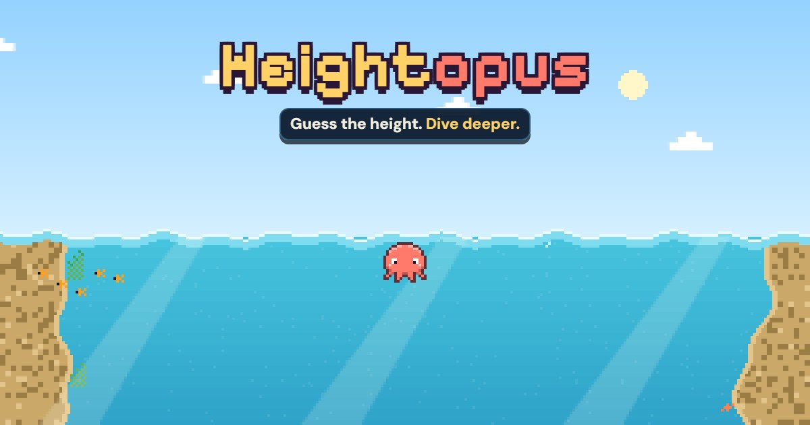
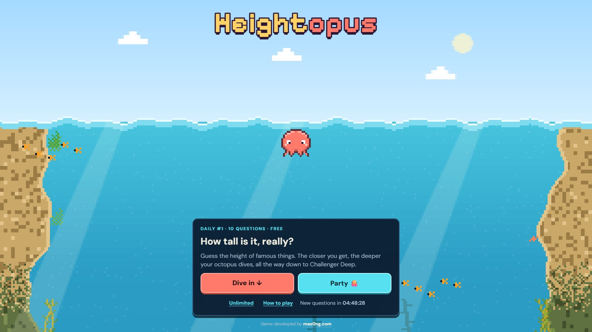
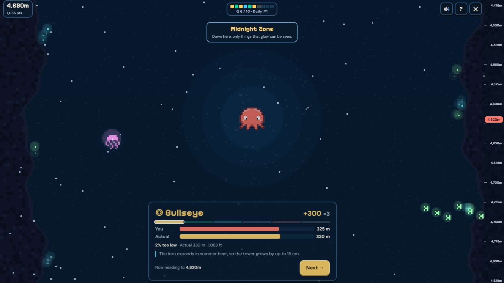
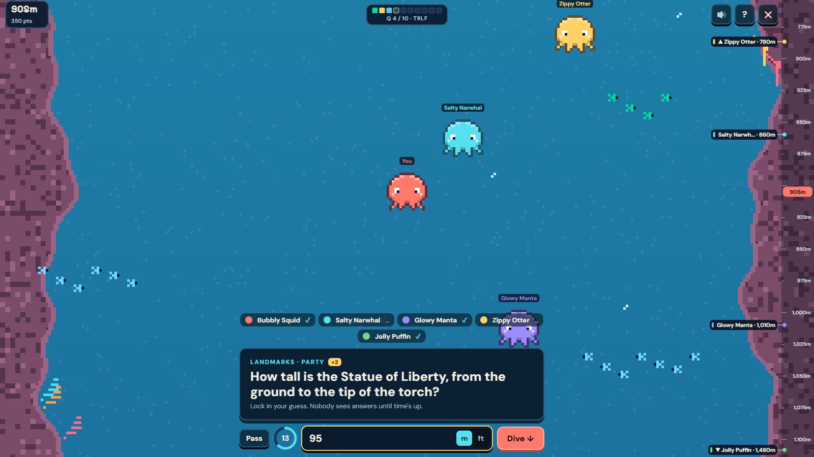

<p align="center">
  <a href="https://heightopus.com"></a>
</p>

<p align="center">
  <b>Guess how tall things are. The closer you get, the deeper your pixel octopus dives.</b><br>
  From the Sunlit Shallows all the way down to Challenger Deep (10,935 m).
</p>

<p align="center">
  <a href="https://heightopus.com"></a>
  <a href="https://heightopus.com/heights/"></a>
  <a href="https://heightopus.com/how-to-play/"></a>
</p>
<p align="center">
  
  
  
</p>

<p align="center">
  <a href="https://heightopus.com"><b>Play now</b></a> ·
  <a href="https://heightopus.com/how-to-play/">How to play</a> ·
  <a href="https://heightopus.com/heights/">All heights</a> ·
  <a href="https://mas0ng.com/projects/heightopus/">Project page</a> ·
  <a href="https://heightopus.com/privacy/">Privacy</a> ·
  <a href="SECURITY.md">Security</a>
</p>

---

## Screenshots

<table>
  <tr>
    <td width="50%"></td>
    <td width="50%"></td>
  </tr>
  <tr>
    <td align="center"><sub><b>Start at the surface.</b> Ten new questions every day.</sub></td>
    <td align="center"><sub><b>Dive deeper.</b> A Bullseye in the Midnight Zone, 4,620 m down.</sub></td>
  </tr>
  <tr>
    <td colspan="2"></td>
  </tr>
  <tr>
    <td colspan="2" align="center"><sub><b>Party rooms.</b> 2–12 people answer at once, and the gauge shows where everyone is.</sub></td>
  </tr>
</table>

## How it works

1. Each question asks how tall, or how high, something is: a skyscraper, a mountain, a giraffe, a basketball hoop.
2. Type a guess in metres or feet within 30 seconds (`300ft`, `1.2k` and `8.8km` all work).
3. The closer you are, the more points you score, and the deeper your octopus dives.
4. Later questions count more: ×1, ×1, ×2, ×2, ×2, ×3, ×3, ×3, ×4, ×4. A perfect day scores 2,500 points.

| | Band | How close | Points |
|---|---|---|---|
| 🟨 | **Bullseye** | within 3% | 100 |
| 🟩 | **Spot On** | within 8% | 75 |
| 🟦 | **Close** | within 18% | 50 |
| 🟪 | **Ballpark** | within 40% | 25 |
| 🟫 | **Way Off** | up to 2× off | 10 |
| ⬛ | **Lost at Sea** | more than 2× off | 0 |

### The ocean zones

| Depth | Zone | |
|---|---|---|
| 0 m | 🌊 Sunlit Shallows | Warm, bright water and curious little fish |
| 150 m | 🌿 Kelp Forest | Swaying golden-green towers of kelp |
| 600 m | 🪸 Coral Drop-off | The reef tumbles away into deep blue |
| 1,500 m | ⚓ Shipwreck Graveyard | Old hulls rest where the light fades |
| 2,600 m | 🌒 Twilight Zone | The last of the sunlight gives out |
| 4,000 m | 🎐 Midnight Zone | Only things that glow can be seen |
| 6,500 m | 🐙 The Abyss | Cold, crushing and very quiet |
| 9,000 m | 🕳️ Hadal Trench | The deepest cracks in the planet |
| 11,000 m | ✨ The Unknown | Nobody has been this deep |

## Features

- **Daily:** ten questions, the same for everyone, new at local midnight. Your result shows how you compare with that day's other divers.
- **Unlimited:** a fresh random set whenever you like.
- **Party rooms:** host with a four-letter code or invite link. Everyone answers at once, then sees every guess ranked. Rejoin after a dropped connection without losing your seat.
- **All pixel art is drawn in code:** no image files for the scene, creatures or octopus.
- **Built for phones and Chromebooks:** the answer bar stays above the on-screen keyboard.
- **Crawlable pages:** `/heights/` has one page per question, plus `/how-to-play/` and a sitemap.

## Folders

| Folder | What it is | Deployed to |
|---|---|---|
| `static/` | The whole site (HTML/CSS/JS, pixel art drawn in code, questions in `data/questions.json`) | Cloudflare (static assets) |
| `worker/` | Small API: party rooms (Durable Objects + WebSockets) and the daily "deeper than X%" stat | Cloudflare Workers |
| `tools/build_pages.py` | Generates `/heights/`, `/how-to-play/`, `404.html` and `sitemap.xml` from the questions | Run before deploying |
| `dev.py`, `run-local.bat` | Local test runner | — |

The worker imports `static/data/questions.json` and `static/js/scoring.js`, so the
site and the API always use the same questions and scoring.

## Run locally

Double-click **`run-local.bat`** (or run `python dev.py`). It:

- rebuilds the static pages,
- installs the worker's packages on first run,
- serves the site on http://localhost:8080,
- runs the API with `wrangler dev` on http://localhost:8787,
- prints a LAN address so you can test on your phone on the same Wi-Fi.

Close the window (or Ctrl+C) to stop both. To test party rooms on one computer, open
http://localhost:8080 and http://127.0.0.1:8080 in two tabs. They count as different players.

## Deploy

**Worker (API):** the `--config` matters: without it Wrangler picks up the site config in the parent folder.
```
cd worker
npx.cmd wrangler deploy --config wrangler.toml
```

**Site (static):** from the project root (uses `wrangler.jsonc`, serves `static/` as
assets with the custom domain `heightopus.com`):
```
python tools/build_pages.py
npx.cmd wrangler deploy
```

How it's wired:
- `heightopus.com` → the `heightopus` site (static assets only, no code runs, free). Unknown URLs get a real 404.
- `heightopus.com/api/*` → the `heightopus-api` worker (route in `worker/wrangler.toml`).
  Both share one origin, so `PROD_API` in `static/js/config.js` stays empty.
- Sitemap: https://heightopus.com/sitemap.xml (also listed in `robots.txt`).
- `www.heightopus.com` is not set up. Add it as a second custom domain in `wrangler.jsonc` if you want it.

## Costs

- Site: static assets only, free.
- Worker + Durable Objects (SQLite-backed) run on the Workers free plan. Rooms use the
  WebSocket hibernation API, so idle connections are not billed; empty rooms delete themselves.
- No database to create: everything lives in Durable Object storage.

## Adding questions

Append to `static/data/questions.json`:

```json
{"id":"unique-id","cat":"Landmarks","q":"How tall is ...?","m":123,"fact":"A fun fact."}
```

Then run `python tools/build_pages.py` (`dev.py` does this automatically) to regenerate the
crawlable pages: `/heights/` (one page per question), `/how-to-play/`, `404.html` and
`sitemap.xml`. Commit the generated files and deploy.

`m` is the answer in metres. Append new questions at the end of the list. The daily
order is a seeded shuffle of the whole list, so editing the list reshuffles future dailies.
Each player's daily is pinned once they start it, so a mid-day edit never changes a run in progress.

Search note: site text and metadata deliberately avoid gaming-related wording and schema
types, so the site isn't caught by web filters that block that category. Keep it that way.

## Security

Please report vulnerabilities privately. See [SECURITY.md](SECURITY.md).

---

<p align="center"><sub>Made by <a href="https://mas0ng.com/projects/heightopus/">mas0ng.com</a></sub></p>
